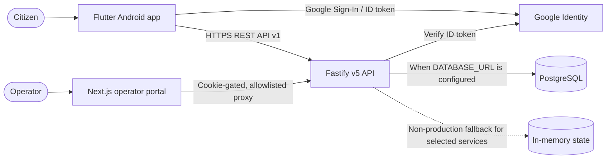
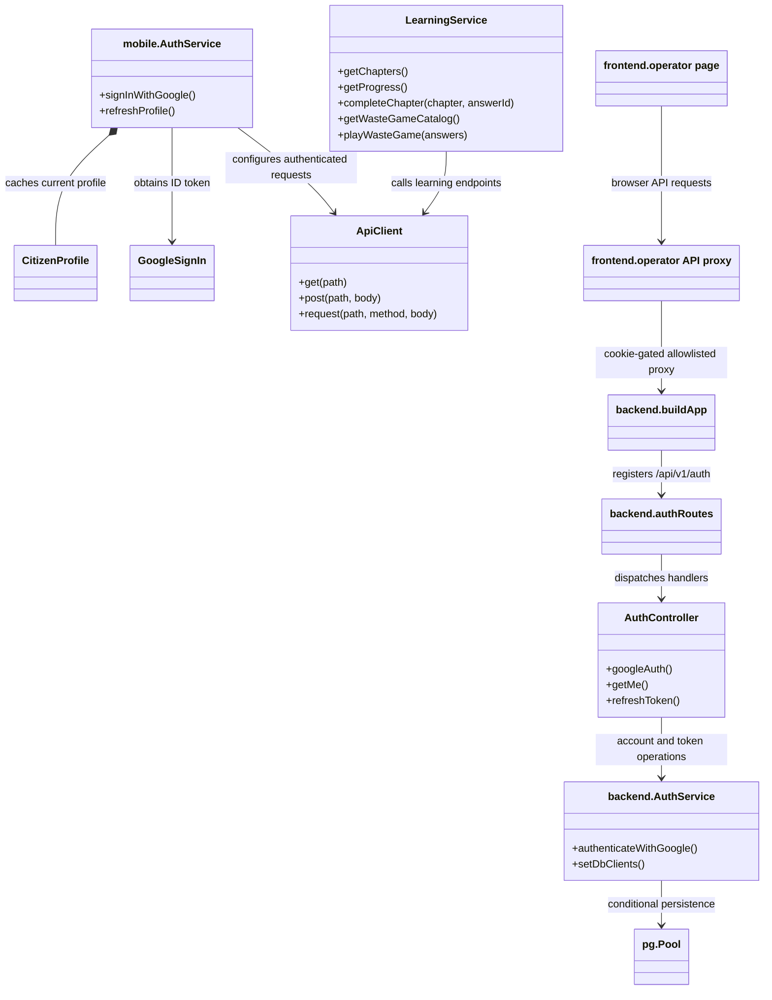

# Architecture and data model

## System context

The diagram distinguishes the Flutter citizen app, the separate Next.js operator portal, the Fastify API, and conditional persistence. The operator proxy forwards only allowlisted API paths and requires its session cookie. The mobile app obtains a Google ID token and sends it to the API; the API verifies the token. PostgreSQL is used when configured; non-production operation can fall back to in-memory stores for selected services.

The system view below describes the committed architecture at revision `d9220214798ced11edd181905fb94e2abfea2898`. It is intentionally not evidence for later uncommitted changes.

### Main code boundaries

- **Mobile:** [Google sign-in and profile service](mobile/lib/services/auth_service.dart), [authenticated API client](mobile/lib/services/api_client.dart), and [API configuration](mobile/lib/constants/auth_config.dart).
- **Operator web:** [operator page](frontend/app/operator/page.tsx), [login route](frontend/app/api/operator/login/route.ts), and [allowlisted proxy route](<frontend/app/api/operator/proxy/[...path]/route.ts>).
- **API:** [Fastify app and route registration](backend/src/app.ts), [authentication routes](backend/src/modules/auth/auth.routes.ts), and [Google token verification](backend/src/modules/auth/auth.service.ts).
- **Persistence:** [PostgreSQL plugin](backend/src/plugins/db.ts) creates a pool only when configured and wires selected services to that pool. The code requires `DATABASE_URL` in production and logs an in-memory fallback for selected services outside production.

Redis, MongoDB, and RabbitMQ have plugin code, but this overview does not depict them as mandatory live dependencies or as a proven high-throughput pipeline. Provisioning, end-to-end use, operational behavior, and capacity must be verified separately.

## Simplified class diagram

This class view names the principal service/controller boundaries in the current implementation; it is not a complete UML inventory.

Evidence: [mobile auth](mobile/lib/services/auth_service.dart), [mobile API client](mobile/lib/services/api_client.dart), [learning client](mobile/lib/services/learning_service.dart), [Fastify routes](backend/src/app.ts), [auth controller](backend/src/modules/auth/auth.controller.ts), [server auth service](backend/src/modules/auth/auth.service.ts), [operator page](frontend/app/operator/page.tsx), and [operator proxy](<frontend/app/api/operator/proxy/[...path]/route.ts>).

## Data domains

The SQL schema groups account/profile and refresh-token records, user-entered utility readings, confirmed trip summaries, manually registered devices and runtime logs, quests and learning completions, garden/mascot state, activity/feed records, and operator/campaign data. See the current [schema.sql](schema.sql).

These records do not all have the same evidentiary meaning: a stored row is not automatically a measured environmental outcome. Utility quantities, appliance hours, and user-confirmed actions need their source and uncertainty retained if they are used for impact reporting. The schema and several feature files currently have uncommitted changes, so verify them against the final commit before treating this description as a release snapshot.
