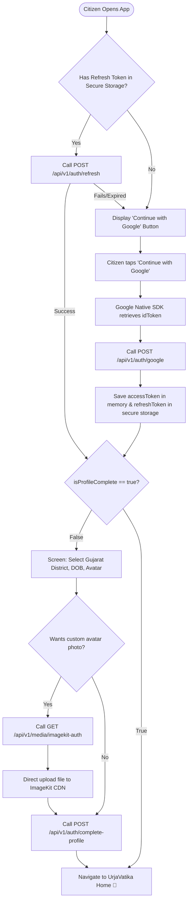

# UrjaVatika Frontend Engineering Specification

**GEDA Mission LiFE Citizen Engagement Application (Problem Statement: HC26-GEDA01)**  
*This document serves as the implementation blueprint for AI agents and human frontend engineers building web (React/Next.js) or mobile (Flutter/React Native) clients.*

---

## 1. High-Level Architectural Flow



---

## 2. API Endpoints Reference for Frontend

| Endpoint | Method | Auth | Body / Query | Expected Response | Action in Frontend |
| :--- | :--- | :--- | :--- | :--- | :--- |
| `GET /health` | `GET` | Public | None | `{ status: "ok" }` | Ping on app launch to verify gateway status |
| `POST /api/v1/auth/google` | `POST` | Public | `{ idToken: string }` | `{ isNewUser, isProfileComplete, accessToken, refreshToken, user }` | Main one-button login/registration |
| `POST /api/v1/auth/complete-profile` | `POST` | Bearer JWT | `{ dob?: string, district: string, avatarUrl?: string }` | `{ success: true, isProfileComplete: true, user }` | Submit onboarding form |
| `GET /api/v1/auth/me` | `GET` | Bearer JWT | None | `{ user }` | Fetch updated points & citizen stats |
| `POST /api/v1/auth/refresh` | `POST` | Public | `{ refreshToken: string }` | `{ accessToken, refreshToken }` | Rotate tokens silently on 401 |
| `POST /api/v1/auth/logout` | `POST` | Bearer JWT | `{ refreshToken?: string }` | `{ success: true }` | Clear local storage & navigate to login |
| `DELETE /api/v1/auth/account` | `DELETE` | Bearer JWT | None | `{ success: true }` | Account deletion / PII scrubbing |
| `GET /api/v1/media/imagekit-auth` | `GET` | Bearer JWT | None | `{ token, expire, signature, publicKey }` | Obtain temporary signature for direct image upload |
| `GET /api/v1/mascot/state` | `GET` | Bearer JWT | None | `{ type, name, level, vitality, mood, equipped, dialogue }` | Render 3D mascot, mood, and active speech bubble |
| `PATCH /api/v1/mascot` | `PATCH` | Bearer JWT | `{ name?: string, type?: "sparrow" \| "squirrel" }` | `{ ...mascotState }` | Rename mascot or toggle species |
| `POST /api/v1/mascot/interact` | `POST` | Bearer JWT | None | `{ vitality, mood, dialogue }` | On tap/click: play chirp animation & sound |
| `GET /api/v1/mascot/wardrobe` | `GET` | Bearer JWT | None | `{ citizenPoints, items: [...] }` | Render Wardrobe Shop (Head, Neck, Body) |
| `POST /api/v1/mascot/wardrobe/buy` | `POST` | Bearer JWT | `{ accessoryId: string }` | `{ success, remainingPoints, item }` | Buy costly accessory (>=100 Urja Mudra) |
| `POST /api/v1/mascot/wardrobe/equip` | `POST` | Bearer JWT | `{ slot: "HEAD" \| "NECK" \| "BODY", accessoryId: string \| null }` | `{ success, equipped }` | Equip or unequip accessory on 3D model |

---

## 3. Dual-Token Management & Silent Refresh

### Token Lifetimes
* **Access Token:** 15 minutes. Store in application memory or global reactive state (Redux / Zustand / Riverpod).
* **Refresh Token:** 30 days. Store in persistent encrypted storage:
  * **Flutter:** `flutter_secure_storage` (Android Keystore / iOS Keychain).
  * **React Native:** `expo-secure-store` or `react-native-keychain`.
  * **Next.js / Web:** `HttpOnly, Secure, SameSite=Lax` cookie OR encrypted local storage.

### Universal HTTP Interceptor (Axios Example)
```typescript
import axios from 'axios';

const api = axios.create({
  baseURL: 'http://localhost:3000/api/v1',
  headers: { 'Content-Type': 'application/json' },
});

let accessToken: string | null = null;

export const setAccessToken = (token: string | null) => {
  accessToken = token;
};

// 1. Attach Access Token to every outgoing request
api.interceptors.request.use((config) => {
  if (accessToken && config.headers) {
    config.headers.Authorization = `Bearer ${accessToken}`;
  }
  return config;
});

// 2. Intercept 401 Unauthorized responses & silently refresh
api.interceptors.response.use(
  (response) => response,
  async (error) => {
    const originalRequest = error.config;
    if (error.response?.status === 401 && !originalRequest._retry) {
      originalRequest._retry = true;
      try {
        const storedRefreshToken = localStorage.getItem('urja_refresh_token');
        if (!storedRefreshToken) throw new Error('No refresh token');

        const { data } = await axios.post('http://localhost:3000/api/v1/auth/refresh', {
          refreshToken: storedRefreshToken,
        });

        setAccessToken(data.accessToken);
        localStorage.setItem('urja_refresh_token', data.refreshToken);

        originalRequest.headers.Authorization = `Bearer ${data.accessToken}`;
        return api(originalRequest); // Retry original request
      } catch (refreshErr) {
        setAccessToken(null);
        localStorage.removeItem('urja_refresh_token');
        window.location.href = '/login';
        return Promise.reject(refreshErr);
      }
    }
    return Promise.reject(error);
  }
);

export default api;
```

---

## 4. Secure ImageKit Direct Upload (Zero Private Key Leakage)

> [!IMPORTANT]
> The private API key **NEVER** goes into the frontend. The frontend calls the backend to receive a temporary HMAC-SHA1 signature and token, then uploads the file directly to ImageKit CDN.

### Implementation Pattern (React / Web & Mobile)
```typescript
import api from './api';

export async function uploadAvatarToImageKit(imageFile: File | Blob): Promise<string> {
  // Step 1: Request temporary upload signature from Fastify backend
  const { data: authParams } = await api.get('/media/imagekit-auth');
  const { token, expire, signature, publicKey } = authParams;

  // Step 2: Upload binary directly to ImageKit CDN
  const formData = new FormData();
  formData.append('file', imageFile);
  formData.append('fileName', `avatar_${Date.now()}.jpg`);
  formData.append('publicKey', publicKey);
  formData.append('signature', signature);
  formData.append('expire', expire.toString());
  formData.append('token', token);
  formData.append('folder', '/urjavatika/avatars');

  const uploadResponse = await fetch('https://upload.imagekit.io/api/v1/files/upload', {
    method: 'POST',
    body: formData,
  });

  if (!uploadResponse.ok) {
    throw new Error('ImageKit direct upload failed');
  }

  const uploadResult = await uploadResponse.json();
  // Return optimized CDN URL (e.g. https://ik.imagekit.io/urjavatika/avatars/avatar_123.jpg)
  return uploadResult.url;
}
```

---

## 5. Screen Hierarchy & Navigation State Machine

```
App Navigation Root
├── Public / Auth Stack
│   └── LoginScreen ("Continue with Google" 1-click button)
│
├── Onboarding Stack (Triggered when isProfileComplete == false)
│   └── CompleteProfileScreen
│       ├── Gujarat District Dropdown (33 Districts: Ahmedabad, Surat, Vadodara, Rajkot, etc.)
│       ├── Date of Birth Picker (Optional)
│       └── Avatar Selector (Uses ImageKit upload or default Google picture)
│
└── Authenticated Main App (Bottom Navigation / Drawer)
    ├── Tab 1: HomeScreen (Mascot vitality, daily sustainability micro-habit cards)
    ├── Tab 2: UrjaVatikaGarden (3x3 grid forest-style garden plot gamification)
    ├── Tab 3: PeakNudgesScreen (Live Gujarat DISCOM peak alerts & appliance shift commits)
    ├── Tab 4: SolarCalculator (Rooftop solar kW estimator & PM Surya Ghar subsidies)
    ├── Tab 5: DistrictLeaderboard (Live state-wide district & ward ranking)
    └── SettingsScreen (View points, Logout, Delete Account)
```

---

## 6. Onboarding Gujarat Districts List
When rendering the district dropdown during onboarding, use Gujarat's official 33 administrative districts:
```typescript
export const GUJARAT_DISTRICTS = [
  'Ahmedabad', 'Amreli', 'Anand', 'Aravalli', 'Banaskantha', 'Bharuch',
  'Bhavnagar', 'Botad', 'Chhota Udaipur', 'Dahod', 'Dang', 'Devbhoomi Dwarka',
  'Gandhinagar', 'Gir Somnath', 'Jamnagar', 'Junagadh', 'Kheda', 'Kutch',
  'Mahisagar', 'Mehsana', 'Morbi', 'Narmada', 'Navsari', 'Panchmahal',
  'Patan', 'Porbandar', 'Rajkot', 'Sabarkantha', 'Surat', 'Surendranagar',
  'Tapi', 'Vadodara', 'Valsad'
];
```

---

## 7. Mascot Stage & Lifelike Speech Engine UI

To make the Sparrow mascot feel like a living companion (Duolingo-style) rather than a static widget:

### A. Dynamic Speech Bubble Presentation
1. **Positioning:** Floating rounded speech bubble placed directly above the mascot's head with a subtle arrow tail pointing down.
2. **Typewriter Effect:** Reveal speech lines letter-by-letter over ~1.2 seconds with a soft flutter/pop sound.
3. **Contextual Badge:** Display a small icon indicator corresponding to `dialogue.context`:
   * `MORNING_SOLAR` ➔ ☀️ Yellow sun icon
   * `PEAK_HOURS` ➔ ⚡ Amber lightning icon
   * `BEDTIME` ➔ 🌙 Soft blue moon icon
   * `LOW_VITALITY` ➔ 💧 Blue droplet icon
   * `TAP` ➔ 🎵 Music note icon

### B. Visual Mood & Animation Mappings
| Mood Received from Backend | Flutter / Web Animation State | Ambient Particle Effect |
| :--- | :--- | :--- |
| `EXCITED` (Vitality >= 80) | Energetic wing flutter, happy hops, bright eyes | Sparkles & solar rays ✨ |
| `HAPPY` (Vitality 50–79) | Gentle bobbing / breathing idle loop, warm smile | Gentle green floating leaves 🍃 |
| `DROOPY` (Vitality 25–49) | Head tilted downward, slower breathing, muted posture | Soft sweat droplet 💧 |
| `SLEEPY` (Vitality < 25) | Eyes closed, slow resting posture on nest perch | Floating Z-Z-Z cloud 💤 |

### C. Wardrobe Shop Modal UI (3 Slots Only)
* **Tabs:** `HEAD` (Solar Cap, Gujarati Paghdi, Straw Hat) · `NECK` (Green Muffler, Eco-Bell) · `BODY` (Leaf Sweater, Khadi Vest).
* **Cost Indicator:** Show item cost in **Urja Mudra** (100–250 coins). Gray out items if citizen balance is insufficient.
* **Equipped Checkmark:** Highlight equipped items with a glowing green badge. Tapping an equipped item dispatches `accessoryId: null` to unequip.
