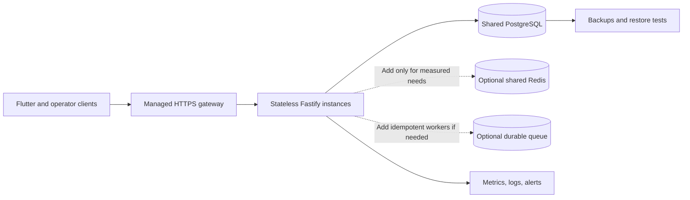

# Scale, verification, and release notes

## What is implemented

The backend is a Fastify v5 API with TypeBox schemas and feature routes. The PostgreSQL plugin creates a connection pool when `DATABASE_URL` is present, with a configured maximum of 10 connections per process. Production startup requires PostgreSQL; non-production mode can use in-memory state for selected services. See [app registration](backend/src/app.ts) and the [database plugin](backend/src/plugins/db.ts).

Redis, MongoDB, and RabbitMQ plugin code is present. Their environment variables are optional, and some plugins report fallback operation when they are absent or unreachable. A dependency declaration, route, or plugin registration is not proof that the service is deployed, that a business path depends on it, or that a scale target is met.

## Performance and availability status

**No production throughput, capacity, latency, or availability figure is verified in this submission.**

The existing [scalability test](backend/test/scalability.test.ts) runs Fastify `inject()` requests against several app objects inside one test process. It is useful as a bounded in-process test, but it does not exercise a deployed HTTP network, multiple hosts, real shared infrastructure, an edge cache, production-sized data, or failover. Its comments and analytical calculations about NGINX, cache-hit ratios, container capacity, and very high request rates are assumptions—not measurements.

Before publishing a numeric scale claim, test the intended deployment with realistic authenticated reads and writes, shared configured dependencies, repeatable load, and recorded p50/p95/p99 latency, throughput, error rate, resource usage, and recovery behavior. State the tested hardware, topology, test data, and duration.

## Profile APK and distribution

- Profile APK: `mobile/build/app/outputs/flutter-apk/app-profile.apk`
- Observed file size: 94,754,753 bytes (about 90.4 MB decimal).
- This is a Flutter **profile-mode** build for performance profiling/internal demonstration; it is not the normal store release artifact.
- The Android Gradle release build requires protected local signing configuration in [app/build.gradle.kts](mobile/android/app/build.gradle.kts). Do not publish the profile APK as a production-signed release. Build from the final committed tree and verify the resulting APK/AAB before distribution.
- The current working tree contains uncommitted application and schema changes. The existing profile APK is not bound to a source revision; rebuild after the final commit.

## Create a signed Android release

The Android Gradle configuration reads a local `mobile/android/key.properties` and refuses `assembleRelease` or `bundleRelease` if valid signing values and the referenced keystore are missing. The keystore and properties file are ignored by Git; keep them private and backed up. Losing an upload key can block future Play Store updates.

1. Install the Android JDK `keytool` (it is included with a JDK) and generate a dedicated upload key. Keep it outside the repository:

   ```powershell
   keytool -genkeypair -v -keystore "$HOME\urja-upload-key.jks" -storetype JKS -keyalg RSA -keysize 2048 -validity 10000 -alias upload
   ```

2. Create `mobile/android/key.properties` locally with your actual values; do not commit it:

   ```properties
   storePassword=YOUR_STORE_PASSWORD
   keyPassword=YOUR_KEY_PASSWORD
   keyAlias=upload
   storeFile=C:\\Users\\YOUR_USER\\urja-upload-key.jks
   ```

   Use the real path and passwords in your local file. Keep the keystore and its passwords backed up securely.

3. Before release, set the API URL and Google **server** OAuth client ID for the production environment. Register the Android app's package name and signing certificate SHA-1 in the Google Cloud OAuth configuration; the release certificate differs from a debug certificate.

4. From `mobile/`, build an APK for direct testing:

   ```powershell
   flutter pub get
   flutter build apk --release --dart-define=API_BASE_URL=https://YOUR_API_HOST/api/v1 --dart-define=GOOGLE_SERVER_CLIENT_ID=YOUR_WEB_CLIENT_ID
   ```

   Or build the preferred Play Console Android App Bundle:

   ```powershell
   flutter build appbundle --release --dart-define=API_BASE_URL=https://YOUR_API_HOST/api/v1 --dart-define=GOOGLE_SERVER_CLIENT_ID=YOUR_WEB_CLIENT_ID
   ```

   Outputs are `build/app/outputs/flutter-apk/app-release.apk` and `build/app/outputs/bundle/release/app-release.aab`, respectively.

5. Test the APK on a clean device/account, verify Google sign-in against the production API, and inspect its signer with Android SDK Build Tools `apksigner verify --verbose --print-certs <apk>`. Increment the `version:` build number in `mobile/pubspec.yaml` for each published build. Upload the AAB to a Play Console internal-testing track before broader release.

Never put passwords, a keystore, `key.properties`, or production service credentials in Git, chat, or a public release artifact. Do not use the already-built debug/profile APK as a production release.

## Suggested scale-out sequence (future work)

1. Decide and document the authoritative PostgreSQL schema/migration process; require production dependencies at startup and remove development-only fallbacks from production paths.
2. Deploy stateless API instances behind a managed load balancer and use a shared database with explicit connection-budget planning.
3. Add Redis or a queue only for measured bottlenecks, with explicit ownership, TTL, retries, idempotency, back-pressure, and monitoring.
4. Add privacy-aware telemetry, request/error/latency metrics, alerts, backups, and tested restore procedures.
5. Run realistic HTTP load/failure tests and publish measured results before making capacity claims.

This sequence is a proposal, not a claim that those deployment controls already exist.



Every component in this diagram is a **proposed validation/deployment direction**, not a claim about the current running environment.
