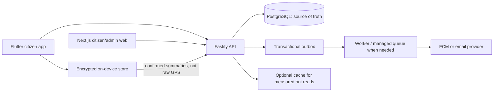

# UrjaVatika: Product, Data, and Scalability Roadmap

**Purpose:** Turn UrjaVatika from a compelling prototype into a trustworthy citizen product that works end to end.

**Planning choices from the brainstorm**

- First release: durable citizen core with the interactive mascot/garden economy, useful daily tasks, utility data, and an impact dashboard.
- Daily task selection: explainable rules first; consider personalization only after gathering useful, consented outcomes.
- Vehicle setup: user-entered vehicle details first. Do not promise number-plate lookup without an authorized data source.
- Travel tracking: opt-in, local-first GPS detection; send only citizen-confirmed trip summaries by default.
- Product surfaces: mobile citizen app, protected Next.js GEDA/provider/city portals, backend/data foundation, and measured operations/scalability.

## 1. Product direction

The product should help a citizen answer four questions reliably:

1. **What can I do today?** A small set of relevant, achievable tasks.
2. **Did it help?** An honest explanation of evidence, estimated impact, and uncertainty.
3. **How am I doing?** A useful trend across electricity, water, gas, travel, and solar where the citizen has supplied data.
4. **What should happen next?** A reminder or recommendation that respects consent, time, and attention.

Build a narrow, complete interactive loop before adding more sensors or infrastructure:

> Profile and consent → provide real household data → receive eligible tasks → record evidence → calculate impact and rewards → update dashboard and mascot → optionally receive a useful reminder.

“Real data” does not mean every value must come from a sensor. A manually entered bill or trip can be useful if it is clearly labeled, dated, attributable to a source, and never presented as independently verified.

### The interactive game is the product loop, not decoration

The sparrow, garden, accessories, chapters, and mini-games should make useful real-world habits enjoyable. Keep the economy understandable and honest:

- **Green Coins** are the spendable game currency. Citizens earn them from learning chapters, daily habit tasks, and the once-per-day waste-sorting game, then spend them on garden items and mascot accessories.
- **CO₂e saved** is an environmental impact measure, not a second spendable currency. Eligible, calculated CO₂e progress becomes the mascot's growth XP and level progression. Keep the source, evidence tier, factor version, and uncertainty visible.
- **Mascot level** must not be purchased with coins. Taps and cosmetic interactions can change a temporary animation or mood, but cannot create environmental impact.
- **Garden and wardrobe state** are user-owned durable data. Purchases, placement, inventory, and equipment must persist across sign-in, app restart, and devices.
- **Learning chapters** award a modest, one-time Green Coin reward for completion (prefer a short knowledge check or reflection over passive screen time). Store chapter version and completion so retries do not pay twice.
- **Waste sorting** is a short, accessible daily mini-game: select an item and place it in the correct local bucket. Give feedback explaining the answer, award Green Coins at most once per citizen/local day, and never claim measured waste diversion unless collection or weighing evidence exists.
- **Daily tasks** should be relevant and useful. If a citizen already did the action, let them log it as already completed and provide the strongest available evidence; do not nag them to repeat it. Label self-report as self-report rather than implying it was independently verified.

The experience loop becomes:

> Learn or do a useful habit → record honest evidence → receive Green Coins and/or calculated CO₂e progress → see the sparrow grow and garden change → get a relevant next action.

### External verification should be real and bounded

Use the strongest practical evidence without pretending every action can be proven:

1. **System-observed:** a device event or local sensor recorded an event (still describe exactly what it proves).
2. **Partner/source-backed:** a provider or official data source confirms a reading, bill, schedule, or service event.
3. **Document/input-backed:** a citizen-entered value or locally processed bill OCR, clearly attributed and correctable.
4. **Context-supported estimate:** a calculation from declared inputs, catalog data, and a versioned factor.
5. **Self-reported:** the citizen says an action happened.

An administrator may review suspicious or disputed records, but a manual review does not turn weak evidence into sensor verification. Keep evidence, confidence, and impact eligibility separate. Add anomaly checks, duplicate detection, and bounded review queues; do not silently reject ordinary citizens based on opaque scoring.

## 2. What the repository currently tells us

The Markdown files contain useful product ideas, but some describe planned behavior as if it were already implemented. Use the source code and tested deployment behavior as the implementation baseline.

| Area | Current evidence | Product implication |
|---|---|---|
| Backend persistence | Auth and daily quest work has been moved toward PostgreSQL. Several other modules still use in-process `Map` state. | A serverless instance restart or another instance can lose or disagree on garden, mascot, device, activity, provider, or leaderboard state. PostgreSQL should become the source of truth before claiming these features are durable. |
| Vehicle and travel | The mobile commute service seeds example vehicles, uses fixed example home/current coordinates, and computes simulated displacement. No durable backend garage/trip API is present. | Treat vehicle and travel as a prototype until real user-managed data, consent, trip confirmation, and persistence exist. |
| Notifications and GPS | Android notification plumbing exists, but the location service contains sample coordinates and simulation helpers. | Replace demo triggers with permission-aware device events, explainable trip states, quiet hours, deduplication, and visible controls. |
| Citizen web app | `frontend/README.md` describes local/device-local prototype data and sample community values. | Do not present web dashboard or community values as synchronized or live until backed by authenticated APIs. |
| Admin | The web README describes `/admin-demo` as illustrative and `/admin` as disabled. Backend admin handlers include fixed KPI values; admin routes need server-side authorization before real use. | Build a real console only on protected, audited, data-backed endpoints. |
| Interactive game | The docs describe a sparrow, garden, wardrobe, chapters, and rewards, but production persistence and authoritative ledgers are incomplete across modules. | Persist both progression tracks and all cosmetic state; never let demo defaults or client state mint durable rewards. |
| Provider and waste operations | The vision includes utility providers and city collection schedules, but there is no verified live integration contract for every provider/city. | Start from provider-maintained, effective-dated schedules and explicitly enrolled users. Do not imply live utility telemetry or official customer access without a partnership/data feed. |
| API documentation | `API.md` mixes implemented endpoints and roadmap endpoints. | Generate the contract from registered route schemas and label planned endpoints as planned, not live. |
| Scale claims | `SCALABILITY.md` and other docs describe Redis, queues, NGINX, and million-request targets, while the tests measure an in-process harness at much lower throughput. | Treat those figures as goals, not verified capacity. Benchmark the deployed database-backed product before selecting infrastructure. |
| Domain rules and values | Several documents give different emission factors, reward rules, and feature boundaries. | Establish versioned, sourced factors and a single canonical product/rules reference before showing savings or rewards. |

Related references: [README.md](./README.md), [API.md](./API.md), [IMPLEMENTATION_SPEC.md](./IMPLEMENTATION_SPEC.md), [SCALABILITY.md](./SCALABILITY.md), [BEHAVIORAL_NUDGES.md](./BEHAVIORAL_NUDGES.md), [frontend/README.md](./frontend/README.md), and [backend/DEPLOYMENT.md](./backend/DEPLOYMENT.md).

## 3. Product principles

1. **No fabricated metrics.** Empty, stale, unavailable, or estimated data must be shown as such; never substitute demo values in a success response.
2. **Trace every impact number.** Store its inputs, source, factor version, calculation version, time period, and evidence/confidence label.
3. **Separate Green Coins from impact.** Coins reward engagement and buy cosmetics. CO₂e is a sourced impact estimate/measurement that can grant mascot XP; it is not spendable and must not be fabricated.
4. **Make existing good behavior count.** Offer “already did this” logging and evidence capture; do not force citizens to repeat a habit just to satisfy the task schedule.
5. **Consent and minimization.** Ask when a feature needs a permission. Keep precise home coordinates and route history on the phone by default.
6. **Useful before clever.** Start tasks with deterministic rules that can be explained and tested. Add learned personalization only after the system has good outcome data and user controls.
7. **Build a modular monolith first.** Keep clear Fastify feature boundaries, but do not split into microservices or add Redis, RabbitMQ, MongoDB, and NGINX without measured need.
8. **Accessibility and low-connectivity support.** Provide manual alternatives, offline-friendly reads, low-bandwidth responses, and recoverable sync.

## 4. Recommended technical shape

### Start with

- **PostgreSQL** for accounts, household profiles, user-owned records, task assignments, claims, impact ledger, admin audit, and durable activity.
- **Fastify modular monolith** with TypeBox schemas and explicit service/repository boundaries.
- **Flutter local storage/outbox** for offline actions and local-only location processing.
- **Next.js** for a citizen web view and a separate, role-protected admin experience.
- **A transactional outbox** for reliable notifications and asynchronous work. Commit the business change and outbox event together, then deliver/retry outside the request.

### Add only when observed

- **Redis:** measured cache pressure, rate limiting, or leaderboard read latency that PostgreSQL indexes/materialized views cannot meet.
- **Managed queue/worker:** notification fan-out, imports, or calculations that exceed a request budget. Preserve retries, dead-letter visibility, and idempotency.
- **Read replica/rollups/partitioning:** only after production query and table-growth measurements justify the additional operational cost.
- **Edge caching:** only for public, non-personal, safely cacheable data. Never share-cache a personalized response.

Do not claim a target capacity from an in-memory benchmark. Publish workload shape, hardware, database/cache configuration, p50/p95/p99 latency, error rate, and the test method with every capacity result.

## 5. Data foundation

Use stable IDs, UTC timestamps, ownership checks, migrations, constraints, and explicit deletion/retention policies. Suggested logical records:

| Domain | Core records | Important behavior |
|---|---|---|
| Identity and household | `users`, `households`, `household_members`, `consents` | A citizen can belong to a household; sensitive feature consent is explicit, versioned, and revocable. |
| Utility profile | `utility_accounts`, `utility_readings`, `bills`, `provider_tariffs` | Store provider, period, units, source (`manual`, import, OCR), and correction history. Never infer a live DISCOM feed where none exists. |
| Catalog and factors | `device_catalog`, `vehicle_catalog`, `emission_factors`, `rule_versions` | Cite source and effective dates. Unknown values stay unknown; do not silently substitute a generic “verified” factor. |
| Tasks and actions | `task_definitions`, `task_assignments`, `task_completions`, `evidence_events` | Snapshot the task/rule version assigned; support “already did this”; claims are idempotent and cannot be rewarded twice. |
| Learning and game | `chapters`, `chapter_versions`, `chapter_completions`, `waste_game_sessions`, `garden_items`, `garden_placements`, `wardrobe_ownership`, `mascot_state` | Store completion version, once-per-day keys, inventory and placement; the server authoritatively grants coins and derives mascot XP from eligible impact. |
| Impact and rewards | `impact_ledger`, `coin_ledger`, `reward_rules` | Append-only adjustments; distinguish measured/estimated/self-reported impact from Green Coins. Balance is derived or transactionally maintained from the ledger. |
| Personalization | `notification_preferences`, `notification_deliveries`, `device_registry` | Store only what the feature requires; enforce caps, quiet hours, opt-outs, and proof/source labels. |
| Travel (later phase) | `vehicles`, `trip_summaries` | Store user-entered vehicle data and confirmed trip summaries; keep raw coordinates on-device by default. |
| Partner operations | `organizations`, `organization_memberships`, `service_areas`, `collection_schedules`, `provider_subscriptions`, `campaigns` | Tenant-scope every provider/city view; schedules are source-attributed, effective-dated, and user-facing reminders require opt-in/eligibility. |
| Operations/admin | `admin_roles`, `admin_audit_log`, `outbox_events` | All privileged actions are authorized, attributable, tenant-scoped, and reviewable. |

### Data correctness requirements

- Add migrations and a documented rollback/forward-recovery procedure; avoid relying on process startup to silently create/alter production schema.
- Enforce foreign keys, uniqueness, check constraints, and ownership in the database/service path.
- Use an idempotency key on retryable writes (task claim, bill submission, trip summary, admin broadcast).
- Make reward calculation atomic with the accepted completion; do not increment a balance in one place and persist the claim later.
- Treat the ledger as the audit source. Current balances and dashboard summaries may be derived/cached views.
- Support export and deletion requests, including a defined retention policy for account, household, event, and notification data.
- Seed only explicitly labeled catalog/reference data. Seed no demo citizens, balances, trips, live-looking KPIs, or “verified” impact.

## 6. Citizen experience roadmap

### Phase 0 — Align and measure

- Resolve conflicting factors, reward rules, and definitions in the existing Markdown files.
- Label every API as **implemented**, **partial**, or **planned**; make `/docs/json` the contract for implemented routes.
- Define a compact event/data dictionary and a privacy/consent inventory.
- Capture baseline backend/mobile/web tests and add an integration environment using a real PostgreSQL service.

**Exit criteria:** One canonical source for factors/rules; docs match route schemas; no silent demo fallback in production paths.

### Phase 1 — Durable citizen core (first release)

- Persist all user-facing state needed for the chosen release. Remove production reliance on in-memory `Map` state for features that promise persistence.
- Add household onboarding with optional utility/provider profile and explicit “unknown/not available” states.
- Support manual entry of electricity, water, and gas readings/bills. Each record has unit, billing period, source, and user correction flow.
- Build an impact dashboard with period comparisons and clear labels: `measured`, `user-entered`, `estimated`, `unavailable`.
- Keep solar as an estimate until real bill/tariff inputs and sourced subsidy assumptions are available.
- Persist Green Coin transactions, mascot XP/level, garden inventory/placements, and owned/equipped accessories. Make purchase/placement changes atomic and recoverable.

**Exit criteria:** A citizen can sign in on a second device and see the same saved profile, readings, tasks, claims, and history; API errors do not become fake success or empty “live” metrics.

### Phase 2 — Explainable daily tasks

Use a server-side, versioned rules engine. Candidate task selection should:

1. Exclude tasks the user is ineligible for (missing household data, unavailable capability, missing consent, already completed, or cooldown).
2. Rank eligible tasks by relevance, season/time, user preference, achievable effort, potential benefit, and fatigue limits.
3. Select a balanced, small daily set instead of repeating the same highest-reward task.
4. Explain **why this task was selected**, what evidence is expected, and what the reward means.
5. Record the assignment/rule version so later decisions are auditable and tests are reproducible.
6. Include an “already did this” path. Accept the citizen's prior action with its honest evidence tier; where a signal or source can corroborate it, attach that evidence, but do not require a repeated action or overstate verification.

Proposed v1 reward rules:

- Coins are an engagement reward for an accepted habit, subject to daily limits and idempotency.
- CO₂e/XP is credited only when the calculation has defined inputs, a versioned source, and an evidence/confidence label.
- A self-report alone does not become “verified savings.”
- A task unavailable due to permissions or missing household data has a manual or “not now” path and does not penalize the citizen.
- Learning chapter completion and waste-sorting game rewards are coin-ledger events, not CO₂e claims. Award chapter completion once per chapter-version policy and the waste game once per citizen/local day.

Start with fixed rules and transparent user controls. Evaluate optional personalization from opt-in completion, dismissal, and usefulness feedback only after enough reliable outcomes exist.

**Exit criteria:** Deterministic unit tests for eligibility, ordering, deduplication, limits, time zones, and rule versions; a retry cannot claim/reward twice; tasks never claim unavailable device signals.

### Phase 3 — Real dashboards and notifications

- Dashboard sections for electricity, water, gas, travel, and solar show what is known, data freshness, source, and comparison period.
- Show actionable recommendations only where sufficient profile/data exists; otherwise offer a clear setup step.
- Make the interactive dashboard show Green Coin balance/history separately from CO₂e/mascot level. Garden previews, mascot dialogue, and progress effects should react to persisted events rather than placeholder totals.
- Schedule local reminders on-device when possible. Use push notifications for cross-device/admin broadcasts only after reliable token lifecycle and delivery tracking exist.
- Add per-category opt-in/out, quiet hours, frequency caps, snooze, and delivery deduplication.
- Never send a reminder that implies current appliance state unless the app actually has that evidence.
- Add provider/city reminders only for a maintained, source-attributed schedule or campaign; show the service area and effective date and let citizens opt out.

**Exit criteria:** Every displayed number is traceable to a ledger/reading; notification retries are safe; user settings reliably suppress delivery.

### Phase 4 — Vehicle garage and travel (next major citizen feature)

- Let the citizen add/edit/remove their own vehicle with type, fuel, optional make/model/year, and user-entered or sourced efficiency.
- Make a license plate optional. Do not use it to reveal owner data or imply automatic RTO/VAHAN lookup. Add a lookup integration only after an authorized provider, permitted purpose, consent, and retention policy are established.
- Detect likely trips on-device only after explicit opt-in and Android permission education. Use OS-supported geofencing/background execution; do not promise continuous tracking or exact detection on every handset.
- Keep precise coordinates and route history in encrypted local storage by default. Upload only a citizen-confirmed trip summary (distance, mode, time period, calculation/evidence label, optional broad region) unless the citizen separately opts into a clearly explained feature that needs more.
- Let the user correct mode, distance, vehicle, and trip boundary. Exclude trips when confidence is poor; do not infer “walk” from GPS alone.
- Calculate emissions from versioned vehicle/fuel factors and declared or sourced efficiency. Compare alternatives honestly; do not reward the same trip in multiple modes.
- Provide manual trip logging for users who deny location or have unreliable background location.

**Exit criteria:** Tests cover permission denied/revoked, GPS drift, duplicate/out-of-order points, app restart, offline sync, trip correction, replay/idempotency, and no raw GPS reaching the API by default.

### Phase 5 — Data-driven mascot and game economy

- Derive mascot growth from accepted impact-ledger entries with evidence labels and factor versions, not from hard-coded totals or arbitrary tap events.
- Keep mood/dialogue as presentation derived from time, recent meaningful actions, and user-configurable companion preferences; it must not fabricate appliance state or carbon impact.
- Persist outfit, garden, inventory, and Green Coin ledger in PostgreSQL with ownership/transaction rules. Display a loading/error state rather than a reset/seeded garden when the API fails.
- Keep three separate concepts: spendable Green Coins, CO₂e-derived mascot XP/level, and lifetime impact history. Streak/consistency is a fourth engagement signal and does not imply impact.
- Animate the sparrow/garden in response to real persisted events: a task accepted, a chapter completed, a level earned, a garden item placed, or a cosmetic equipped. Cosmetic purchases must not change impact or level.
- Make the citizen see the reward and consequence before confirming a purchase; the server validates ownership, price, balance, unlock level, placement, and idempotency atomically.

**Exit criteria:** Mascot and garden remain consistent across sessions/devices; balance changes are auditable; failed persistence never reports a successful purchase or reward.

### Phase 6 — Chapters, waste-sorting game, and city schedules

- Publish short, versioned learning chapters with clear objectives, accessible content, and optional quiz/reflection. Award Green Coins once according to a server-side completion policy; never reward repeated refreshes.
- Build the daily waste-sorting mini-game around a versioned item-to-bucket catalog. Include locally relevant categories and plain-language explanations for ambiguous materials.
- Ask for the user's city/service area (not continuous GPS) to show collection schedules. Start with schedules entered/confirmed by a municipal or collection partner, with source, last-verified date, effective range, and a “report schedule problem” path.
- Let a city waste operator maintain schedules and publish reminders for their verified service areas. Do not assume every neighborhood follows the same schedule or that a reminder proves waste was collected.
- Make the game usable offline and sync the result with an idempotency key. Enforce at most one reward per user-local date on the server.

**Exit criteria:** Content versions and schedule changes are auditable; daily rewards cannot be replayed; wrong/uncertain sorting feedback is handled without false claims about real-world waste diversion.

### Phase 7 — Protected admin and partner portals

Build the Next.js portal around one login surface with distinct tenant-scoped views:

- **GEDA platform admin:** manage organizations, roles, approved rules/content, statewide aggregate metrics, and escalations.
- **Electricity/gas/water provider admin:** see only the provider's authorized service area and enrolled/subscribed users or aggregated cohorts; publish educational reminders and campaigns with approvals and delivery metrics.
- **City/waste operator admin:** maintain effective-dated neighborhood collection calendars, publish schedule reminders, and see aggregate engagement/issue reports for their own service areas.
- **Support/reviewer role:** handle flagged evidence or user-reported schedule/content issues, with no unnecessary access to household details.

Use an admin-specific email/password login rather than Google sign-in if that is the desired operational model. Hash passwords with a modern password-hashing algorithm; issue short-lived JWTs in `HttpOnly`, `Secure`, `SameSite` cookies (not browser local storage); rotate refresh/session credentials, rate-limit login, support revocation, and add MFA for high-privilege roles when practical. Backend APIs—not just Next.js middleware or hidden UI—must enforce role and organization scope on every request.

- Replace hard-coded KPIs with database-backed, timestamped aggregates and visible definitions/coverage.
- Support read-only operational views first: data freshness, task/chapter/game engagement, notification delivery, service-area schedules, and regional aggregates.
- Let partners contact only eligible, consented/enrolled users for their own service. Use campaign preview, approval, targeting bounds, rate limits, delivery results, and immutable audit events.
- Avoid exposing personal trip routes, home coordinates, plates, household bills, and individual utility readings in general analytics or to unrelated partners.

**Exit criteria:** Unauthorized and cross-tenant calls fail at the API; privileged changes record actor, organization, time, scope, before/after, and request reason; dashboard KPIs can be reconciled to source records.

## 8. GPS, privacy, and notification safeguards

- Request location permission only at the moment the citizen enables trip detection; explain foreground/background requirements and provide manual trip entry.
- Treat background location as optional, revocable, and OS/device-dependent. If permission is absent, do not degrade unrelated app features.
- Keep location calculation local. Do not include home coordinates, SSID, raw route, or precise location in logs, analytics, crash reports, or API payloads.
- Use a local trip state machine (home/away, likely trip, awaiting confirmation, accepted/ignored) with hysteresis and minimum duration/distance to reduce GPS jitter.
- Avoid interactions that encourage phone use while driving. Show a post-trip review, not a live driving notification.
- Use local notification scheduling for personal reminders; central push is for events that need server fan-out. Persist delivery attempts/results and respect quiet hours, cooldowns, and user preferences.
- Keep consent records versioned and make revoke/delete behavior testable.
- Provider access must be tied to a documented data-sharing purpose, verified service relationship, least-privilege role, and tenant-scoped query. Prefer cohort aggregates unless individual outreach is needed and consented.
- Show which organization published a reminder and why the citizen received it. Allow category-level opt-out without removing access to the rest of the app.
- Store chapter/game answers only as needed for completion, learning quality, and abuse prevention; do not use quiz mistakes to reduce rewards earned elsewhere.

## 9. Scalability and reliability plan

### Correctness before throughput

1. Remove in-memory persistence for production features and confirm behavior with multiple app instances.
2. Add PostgreSQL indexes from actual queries, connection pool limits suitable for Vercel/serverless, query timeouts, and health/readiness checks.
3. Use cursor pagination for activity/trip history and bounded response sizes.
4. Make writes idempotent; use transactions for claims, reward ledger entries, purchases, and user-visible state.
5. Move slow external work to an outbox/worker; retries must not duplicate user-visible actions.

### Measure before adding infrastructure

Track request volume, p95/p99 latency, error rate, pool wait time, slow queries, queue age, notification delivery, and event-loop delay. Load-test realistic authenticated reads and writes against PostgreSQL, including a restart and an instance scale-out.

Add caching only for a measured bottleneck, with explicit invalidation and no personalized cross-user cache keys. Use precomputed aggregates for admin dashboards if live aggregation becomes expensive. Partition append-only data only after row volume and retention needs are measured.

### Capacity claim policy

The current 1M reads/s and 100k writes/s figures in the planning docs are aspirational. Do not use them in a production readiness claim unless a reproducible environment has tested the complete deployed path—including TLS/edge, Fastify, PostgreSQL, queue/cache, and failover—with recorded workload and latency/error results.

## 10. Cross-platform API conventions

- Fastify route schemas define request/response contracts and OpenAPI. Treat them as the source for mobile/web clients.
- Use consistent response/error shapes, status codes, pagination, UTC timestamps, and versioned enums.
- Use authenticated ownership-scoped endpoints for citizen records; never accept a target user ID from the client as proof of ownership.
- Proposed future endpoint groups (names are placeholders until reviewed against existing routes):
  - `/profile` and `/household`
  - `/readings` and `/impact`
  - `/tasks/daily`, `/tasks/:id/complete`
  - `/chapters`, `/chapters/:id/complete`, `/waste-game/daily`
  - `/vehicles` and `/trips`
  - `/notifications/preferences`
  - `/organizations/:id/schedules`, `/organizations/:id/campaigns`
  - `/admin/metrics`, `/admin/campaigns`, `/admin/audit`
- Generate typed client models from OpenAPI where practical; add contract tests so the documented contract cannot drift.

## 11. Definition of a trustworthy first release

A release is ready when:

- A real citizen can register, complete a household profile, and resume the same data across devices.
- A citizen can enter a utility reading or bill and see a correctly labeled, traceable dashboard value.
- A citizen can earn and spend Green Coins on persisted garden/mascot customizations; CO₂e-derived mascot growth is separately calculated and traceable.
- Daily tasks are relevant to available data/permissions, explain their selection, support logging something already done, and cannot be double-claimed.
- A chapter completion and daily waste-sorting session award the defined coin amount exactly once; neither implies measured environmental impact.
- No empty/error response is replaced by demo values or a success-shaped fallback.
- All user-facing state advertised as saved survives an instance restart and is visible from another instance.
- Privacy settings and data deletion are documented and exercised in tests.
- Admin routes remain disabled until server-side authorization, tenant scope, and audit are implemented.
- Build, lint, focused integration tests, and a production-like PostgreSQL test pass; real device permission and offline-sync tests are recorded.

## 12. Decisions still to make before implementation

These are product choices, not assumptions baked into this roadmap:

1. Which utility input ships first: electricity bills/readings only, or electricity plus manual water and gas readings?
2. What are the Green Coin amounts, chapter completion rule, and daily waste-game reward? Keep values configurable and versioned; tune them with a pilot rather than assuming high rewards improve habits.
3. What is the daily task count and balance? Validate a few optional tasks against user attention and completion rather than maximize notifications.
4. Which impact factors/data sources are officially approved for the first geography and time period?
5. Which city and waste-collection partner can provide a verified, maintained collection schedule for the first pilot?
6. Which providers have agreed to a data-sharing or campaign relationship, and what customer-level access is contractually permitted?
7. Is web citizen experience in the first release, or is web initially admin-only?
8. Which deployment target and database plan are intended for the first production pilot?
9. What is the pilot size and what success measures matter most: retained active citizens, task usefulness, verified data coverage, utility reduction, or notification opt-in?

## 13. Suggested next work item

Start with a short **data and behavior contract** for the game economy and durable citizen core: Green Coin earning/spending, CO₂e evidence and mascot XP, chapter completion, daily waste-game limits, garden/wardrobe state, utility-reading sources, and the “already did this” task flow. Then implement PostgreSQL migrations/repositories and one complete journey end to end before converting the remaining modules. For partner operations, separately document the first provider/city pilot, tenant permissions, data-sharing boundary, and collection-schedule source. Keep this roadmap as the agreed scope reference and update it when a decision above is made.
